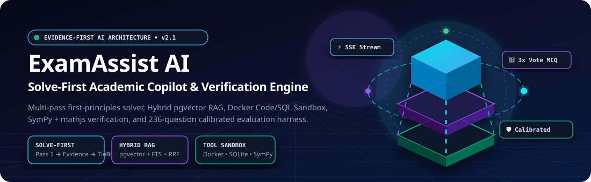
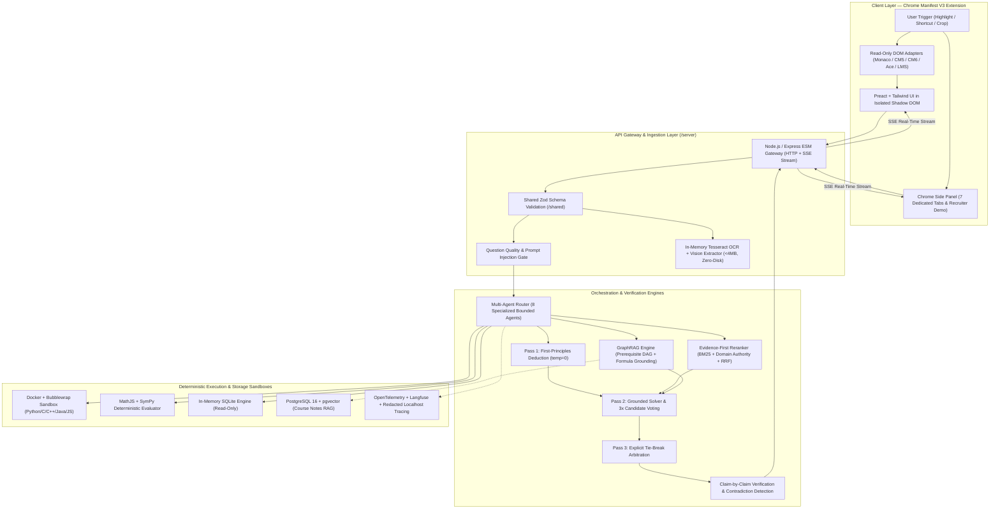
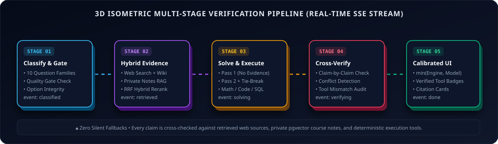
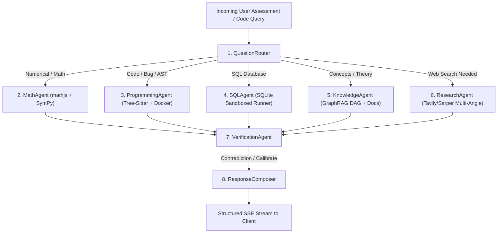

<div align="center">



<br/>

[](https://github.com/sathvikkasanagpttu/ExamAssist-AI/releases)
[](#-langfuse-ai-observability--agent-skills)
[](.agents/skills/langfuse/SKILL.md)
[](https://nodejs.org/)
[](https://www.typescriptlang.org/)
[](https://developer.chrome.com/docs/extensions/mv3/)
[](https://preactjs.com/)
[](#-graphrag--academic-knowledge-graphs)
[](#-private-course-notes-hybrid-rag)
[](#-agentic-ai--specialized-agent-routing)
[](#-specialized-solver-matrix--execution-sandbox)
[](server/eval/dataset.jsonl)
[](#-automatic-gemini--openai-model-resilience)

<h3>An Evidence-First, Solve-Before-Search Academic Copilot & Multi-Stage Verification Engine for Practice Assessments, Coding Problem Sets, and Authorized Coursework.</h3>

<p align="center">
  <a href="#-overview--core-philosophy">Overview</a> •
  <a href="#-system-architecture--dual-engine-topology">Architecture</a> •
  <a href="#-the-11-stage-verification-pipeline">11-Stage Pipeline</a> •
  <a href="#-graphrag--academic-knowledge-graphs">GraphRAG</a> •
  <a href="#-agentic-ai--specialized-agent-routing">Agentic AI</a> •
  <a href="#-evidence-first-reranker--contradiction-detection">Reranker</a> •
  <a href="#-specialized-solver-matrix--execution-sandbox">Sandboxing</a> •
  <a href="#-chrome-extension-ui--recruiter-showcase">Side Panel & Demo</a> •
  <a href="#-quick-start-guide">Quick Start</a> •
  <a href="#-configuration--environment-variables">Configuration</a> •
  <a href="#-evaluation-harness--ablation-benchmarks">Benchmarks</a> •
  <a href="#-api-summary--endpoints">API Reference</a>
</p>

</div>

---

## 🌟 Overview & Core Philosophy

**ExamAssist AI** is an enterprise-grade academic assessment copilot and study platform engineered for students, educators, and software engineers. Built on a modular **Node.js / Express ESM** backend, an isolated **Docker + Bubblewrap + Seccomp** multi-language sandbox, and a **Chrome Manifest V3 Extension** (TypeScript + Preact + Tailwind CSS rendered inside an encapsulated **Shadow DOM**), it transforms raw AI generation into a calibrated, reproducible, and verifiable learning partner.

### The Problem with Conventional LLM Study Tools
Most AI homework solvers suffer from catastrophic shortcomings:
1. **Hallucinated Answers**: Large language models confidently guess mathematical formulas, invent code syntaxes, or swap multiple-choice letters without verification.
2. **Ghost Citations**: AI wrappers generate fabricated URLs, book chapters, or academic papers that do not exist.
3. **Sycophancy & Lazy Guesswork**: When presented with malformed questions or contradictory claims, standard models generate plausible-sounding rationalizations rather than admitting uncertainty.
4. **Academic Dishonesty & Proctor Evasion**: Many student extensions inject stealth keystrokes, conceal windows from screen shares, and automate submissions—violating academic integrity standards.

### The ExamAssist AI Manifesto: Epistemic Honesty
ExamAssist AI is engineered around **strict epistemic honesty and responsible pedagogy**:

```
                               ┌─────────────────────────────┐
                               │   RAW QUESTION INGESTION    │
                               └──────────────┬──────────────┘
                                              │
                              Stage 2: Question Quality Gate
                                              │
                      ┌───────────────────────┴───────────────────────┐
                      ▼                                               ▼
         [ Ambiguous / Malformed ]                          [ Clear & Actionable ]
                      │                                               │
             Return UNVERIFIED                              Stage 4: First Principles
         + Prescribe Clarifications                         (temp=0, no web access)
                                                                      │
                                                    Stage 5 & 6: Search & GraphRAG
                                                                      │
                                                    Stage 7: Deterministic Solvers
                                                    (Docker / MathJS / SQLite)
                                                                      │
                                                    Stage 8: Evidence-Grounded Pass
                                                                      │
                                                    Stage 9: Tie-Break Arbitration
                                                                      │
                                                    Stage 10: Contradiction Check
                                                                      │
                                                    Stage 11: Epistemic Confidence
                                                    min(EngineScore, ModelScore)
```

1. **User-Triggered Plain-Sight Operation**: Operates strictly via user action (button click, text highlight, region capture). **Zero proctor evasion, zero DOM cloaking, zero screen-share hiding, and zero automated submissions.**
2. **Solve-First, Verify-Second Principle**: The core engine solves every problem from first principles ($\text{temperature} = 0$) *before* looking up external sources, eliminating anchor bias.
3. **Deterministic Tool Grounding**: Math is verified by `mathjs` and SymPy, code is executed inside Docker containers, and database queries run in SQLite. Discrepancies between AI prose and tool execution always trust the tool.
4. **Epistemic Confidence Scoring**:
   $$\text{Final Confidence} = \min\big(\text{Engine Confidence}, \text{Model Confidence}\big) \times \prod \text{Penalties}$$
   When evidence is conflicting or absent, confidence drops to `UNVERIFIED` or `LOW`—never falsely inflated to `HIGH`.
5. **Practice Mode vs. Authorized Assessment Mode**:
   - *Practice Mode*: Displays step-by-step reasoning, AST complexity analysis, test outputs, and unified diffs.
   - *Assessment Mode*: Masks the final answer behind an explicit confirmation gate with an institutional integrity reminder.

---

## ⚖️ Architectural Comparison Matrix

| Capability | Generic LLM Chatbots | Commercial Homework Extensions | **ExamAssist AI (v2.3.0)** |
| :--- | :---: | :---: | :---: |
| **Solving Paradigm** | Monolithic single prompt | Direct web scraping + prompt | **Solve-First, Verify-Second 11-Stage Pipeline** |
| **LLM Observability** | Blind execution / Black box | Basic server logging | **Langfuse Agent Skills + OpenTelemetry Tracing Hierarchy** |
| **Mathematical Reasoning** | Probabilistic text prediction | Probabilistic text prediction | **Deterministic `mathjs` + SymPy Symbolic Evaluator** |
| **Code Verification** | Untested hallucinated code | Static linters / Regex | **Docker + Seccomp + Bubblewrap Isolated Runner** |
| **Relational Knowledge** | Vector search only (top-$k$) | Vector search only (top-$k$) | **GraphRAG Prerequisite DAG + Multi-Hop BFS** |
| **Evidence Reranking** | Cosine similarity cutoff | None | **BM25 Saturation + Domain Authority + RRF ($k=60$)** |
| **Contradiction Detection** | None (sycophantic agreement) | None | **Automated Claim Extraction & Semantic Opposing-Claim Flagging** |
| **Complexity Analysis** | Static LLM speculation | None | **Dual Estimation: AST Structural + 5-Size Log-Log Regression** |
| **Browser Integration** | Copy-paste to separate tab | Injected content scripts | **Encapsulated Preact + Tailwind in Shadow DOM + Chrome Side Panel** |
| **Multimodal Extraction** | Full-page screenshot upload | Full-page screenshot upload | **Local Crop Preview + In-Memory OCR + Zero Disk Persistence** |
| **Agentic Tooling** | Unbounded autonomous loops | Single-turn API call | **8 Specialized Bounded Agents with Typed Schema Gates** |
| **Academic Ethics** | Ignores institutional policies | Stealth / Anti-Proctor modes | **Plain-Sight User Triggers, Read-Only Adapters, Practice/Exam Gate** |

---

## 🧊 System Architecture & Dual-Engine Topology



---

## 🔄 The 11-Stage Verification Pipeline

<div align="center">
  
</div>

<br/>

Every query entering ExamAssist AI passes through an 11-stage rigorous pipeline:

```mermaid
flowchart LR
    S1["1. Read-Only Ingest"] --> S2["2. Quality Gate"]
    S2 --> S3["3. Classification"]
    S3 --> S4["4. Pass 1: First Principles"]
    S4 --> S5["5. Multi-Angle Search"]
    S5 --> S6["6. Hybrid RAG & GraphRAG"]
    S6 --> S7["7. Deterministic Solvers"]
    S7 --> S8["8. Pass 2: Evidence Solver"]
    S8 --> S9["9. Tie-Break Arbitrator"]
    S9 --> S10["10. Contradiction Check"]
    S10 --> S11["11. Epistemic Calibration"]
```



### 1. Read-Only Ingestion & Normalization
Captures question text via non-invasive DOM extractors supporting **Monaco Editor, CodeMirror 5/6, Ace Editor, standard `<textarea>`, Moodle, Canvas LMS, Blackboard, LeetCode, HackerRank**, or interactive local rectangle screenshot. No DOM mutation or synthetic events are performed on the host page.

### 2. Question Quality Gate ([`server/pipeline/questionQuality.js`](server/pipeline/questionQuality.js))
Validates structural integrity before invoking AI models. If a question has missing options, truncated code blocks, ambiguous pronouns without context, or prompt-injection markers, the gate immediately halts execution, returning `UNVERIFIED` with actionable clarification instructions.

### 3. 10-Family Question Classification & Option Integrity
Classifies queries into 10 structured families: `MCQ`, `MULTI_SELECT`, `TRUE_FALSE`, `NUMERICAL`, `CODING`, `SQL`, `CONCEPTUAL`, `DEBUGGING`, `OUTPUT_PREDICTION`, or `SHORT_ANSWER`. Ensures that option letters (e.g., "A", "B") match their corresponding text bodies to eliminate option-swapping traps.

### 4. Pass 1: First-Principles Deduction
The question is solved in isolation at strict $\text{temperature} = 0$ with zero external web or note evidence. This guarantees that foundational logical reasoning is established without search noise or biased snippets.

### 5. Multi-Angle Query Synthesis & Search Retrieval
Generates 3 to 6 targeted, orthogonal search queries (definitional, conceptual contrast, edge case). Queries external search APIs (`Tavily`, `Serper`, `Brave`, or local Wikipedia mirror) with domain authority scoring.

### 6. Private Course Notes Hybrid RAG & GraphRAG Traversal
Simultaneously queries student-uploaded course notes using PostgreSQL `pgvector` Cosine Similarity + `tsvector` Full-Text Search fused via Reciprocal Rank Fusion ($k=60$), while traversing the academic knowledge graph for prerequisites and formulas.

### 7. Deterministic Solver Execution
Dispatches specialized problems to non-probabilistic engines:
- `NUMERICAL`: Evaluated via `mathjs` expression tree and SymPy.
- `CODING` / `DEBUGGING`: Compiled and executed inside the isolated Docker sandbox.
- `SQL`: Executed against an isolated, fresh in-memory SQLite database instance.

### 8. Pass 2: Evidence-Grounded Solver & 3x Candidate Voting
Re-solves the problem conditioned upon retrieved citations, prerequisite concepts, and deterministic tool outputs. For MCQs, executes 3 independent candidate passes across sampling temperatures ($T \in \{0.0, 0.2, 0.4\}$) with majority voting.

### 9. Pass 3: Explicit Tie-Break Arbitration
Invoked **only** when Pass 1 (first-principles) and Pass 2 (evidence-grounded) reach differing conclusions. An independent arbitration prompt evaluates the logical deduction against empirical evidence. Whenever arbitration is triggered, final confidence is capped at `LOW`.

### 10. Claim-by-Claim Verification & Contradiction Detection
Extracts individual claims from the generated solution and verifies them against retrieved literature. Identifies semantic contradictions between sources (e.g., opposing time complexities or contradictory definitions) and flags them explicitly.

### 11. Epistemic Confidence Calibration & SSE Streaming
Calculates the final confidence rating (`HIGH`, `MEDIUM`, `LOW`, or `UNVERIFIED`) based on agreement across passes, tool verification, option alignment, and source authority. Streams structured progress and results via Server-Sent Events (SSE).

---

## 🌐 GraphRAG & Academic Knowledge Graphs

Standard RAG searches for textual similarity, but academic learning requires **relational understanding of prerequisites, formulas, and common pitfalls**. ExamAssist AI integrates a specialized GraphRAG engine ([`server/kb/graphRAG.js`](server/kb/graphRAG.js)).

```
                       ┌─────────────────────────┐
                       │    Discrete Math        │
                       └────────────┬────────────┘
                                    │ (prerequisite)
                                    ▼
                       ┌─────────────────────────┐
                       │     Graph Theory        │
                       └──────┬───────────┬──────┘
                              │           │
           ┌──────────────────┘           └──────────────────┐
           ▼                                                 ▼
┌──────────────────────┐                         ┌──────────────────────┐
│  Breadth-First Search│                         │    Priority Queue    │
└──────────┬───────────┘                         └───────────┬──────────┘
           │                                                 │
           └──────────────────┐           ┌──────────────────┘
                              ▼           ▼
                       ┌─────────────────────────┐
                       │   Dijkstra's Algorithm  │
                       └────────────┬────────────┘
                                    │ (formula: d(v) = min(d(v), d(u) + w(u,v)))
                                    │ (pitfall: Fails with negative weight edges)
                                    ▼
                       ┌─────────────────────────┐
                       │  A* / Bellman-Ford /    │
                       │     Shortest Paths      │
                       └─────────────────────────┘
```

### Core GraphRAG Capabilities
1. **Multi-Hop Prerequisite BFS Traversal**: Traverses the concept DAG up to depth $d$. When a student asks about *Dijkstra's Algorithm*, the engine surfaces foundational prerequisites (*Graph Theory*, *Priority Queue*, *Breadth-First Search*) to diagnose knowledge gaps.
2. **Formula-to-Variable Grounding**: Mathematical concepts link to exact symbolic expressions with strictly typed parameter definitions:
   $$\text{Bayes' Theorem}: \quad P(A|B) = \frac{P(B|A) \cdot P(A)}{P(B)}$$
   Where $P(A|B)$ is the posterior, $P(B|A)$ is the likelihood, $P(A)$ is the prior, and $P(B)$ is marginal probability.
3. **Misconception & Pitfall Detection**: Directly alerts students to canonical traps (e.g., attempting to apply Dijkstra's algorithm to graphs with negative weight edges, or confusing Quicksort worst-case $\mathcal{O}(N^2)$ with average-case $\mathcal{O}(N \log N)$).
4. **PostgreSQL Relational Schema**: Persisted in PostgreSQL via [`server/db/migrations/002_knowledge_graph.sql`](server/db/migrations/002_knowledge_graph.sql):
   - `kb_concepts`: Concept definitions, domains, and difficulty tiers.
   - `kb_prerequisites`: Directed edges with dependency types (`strict`, `recommended`).
   - `kb_formulas`: LaTeX representations, variables, and units.
   - `kb_pitfalls`: Common student misconceptions and counter-examples.

---

## 🧠 Agentic AI & Specialized Agent Routing

Rather than passing complex questions to a single bloated prompt, ExamAssist AI implements an 8-agent typed routing topology ([`server/pipeline/agentRouter.js`](server/pipeline/agentRouter.js)).



### The 8 Specialized Bounded Agents
| Agent | Role & Capabilities | Tool Integrations | Bounded Safety Ceiling |
| :--- | :--- | :--- | :--- |
| **`QuestionRouter`** | Classifies problem family, extracts parameters, identifies missing context. | Quality heuristics, token analyzer | Max 1 routing turn |
| **`MathAgent`** | Isolates mathematical formulas, evaluates exact numerical expressions. | `mathjs`, SymPy calculus | Exact float precision, no eval() |
| **`ProgrammingAgent`** | Inspects syntax, executes test cases, computes complexity. | Tree-Sitter WASM, Docker Sandbox | 2s timeout, 512MB RAM, no net |
| **`SQLAgent`** | Seeds ephemeral schemas, validates query plans, executes read-only SQL. | SQLite in-memory, AST parser | Disallows `DROP/DELETE/UPDATE` |
| **`KnowledgeAgent`** | Traverses prerequisite DAGs, retrieves official documentation. | GraphRAG BFS, MDN/Python docs | Max depth = 3 hops |
| **`ResearchAgent`** | Synthesizes multi-angle search queries, filters institutional domains. | Tavily, Serper, Brave, Wiki | Max 6 queries per problem |
| **`VerificationAgent`** | Compares Pass 1 vs Pass 2, verifies claims against citations. | Sentence extractor, claim matcher | Deterministic threshold check |
| **`ResponseComposer`** | Formats final structured JSON, builds lazy hints, renders diffs. | Markdown parser, Zod validator | Max 2000 tokens response |

---

## 🔬 Evidence-First Reranker & Contradiction Detection

Retrieved passages are scored and pruned by the Evidence-First Reranker ([`server/pipeline/reranker.js`](server/pipeline/reranker.js)):

### 1. BM25 Lexical Term Saturation
Computes lexical match with frequency saturation and length normalization:
$$\text{Score}_{\text{BM25}}(D, Q) = \sum_{i=1}^{n} \text{IDF}(q_i) \cdot \frac{f(q_i, D) \cdot (k_1 + 1)}{f(q_i, D) + k_1 \cdot \left(1 - b + b \cdot \frac{|D|}{\text{avgdl}}\right)}$$
*(Configured with $k_1 = 1.2$, $b = 0.75$, and academic stopword pruning).*

### 2. Institutional Domain Authority Scoring
Weights sources based on educational rigor and official provenance:
- **Tier 1 (Authority 0.95–1.00)**: `.edu`, `.gov`, RFC standards, official documentation (`python.org`, `cppreference.com`, `docs.oracle.com`, `developer.mozilla.org`).
- **Tier 2 (Authority 0.75–0.85)**: Peer-reviewed encyclopedias (`wikipedia.org`, `arxiv.org`, `acm.org`).
- **Tier 3 (Authority 0.40–0.60)**: Community engineering forums (`stackoverflow.com`, `github.com`).
- **Tier 4 (Authority 0.10–0.25)**: Social platforms, blogs, unverified answer aggregators.

### 3. Reciprocal Rank Fusion (RRF)
$$\text{RRF}(d) = \sum_{m \in \{\text{BM25}, \text{Authority}, \text{Vector}\}} \frac{1}{k + \text{rank}_m(d)} \quad (k=60)$$

### 4. Semantic Contradiction Detection
Parses extracted claims from both the model's hypothesis and top retrieved sources. Identifies contradictory assertions (e.g. claim $A$: *"Dijkstra supports negative edge weights"* vs claim $B$: *"Dijkstra may loop indefinitely or yield incorrect shortest paths on negative edges"*). When a contradiction is verified, the system sets status to `CONFLICTING` and downgrades overall confidence.

---

## 🛠️ Specialized Solver Matrix & Execution Sandbox

<div align="center">
  
</div>

<br/>

| Problem Family | Solver Engine | Security & Sandboxing Architecture | Verification Badge |
| :--- | :--- | :--- | :--- |
| **Numerical & Math** | `mathjs` + SymPy | Deterministic AST evaluation; disallows arbitrary JavaScript execution; handles fractions, complex numbers, matrices. | `Verified by: calculator` |
| **Coding & Algorithms** | Docker Container | Read-only root filesystem, non-root user (`uid 1000`), no network (`network_mode: none`), 512MB RAM cap, 2s wall-clock ceiling. | `Verified by: sandbox` |
| **Database Queries** | SQLite In-Memory | Fresh in-memory DB per request; seeds schema and mock rows; strictly permits only `SELECT` and `WITH`; blocks destructive DDL/DML. | `Verified by: sql` |
| **Multiple Choice** | 3x Candidate Voting | Multi-temperature voting ($T \in \{0.0, 0.2, 0.4\}$) + bidirectional option letter/text validator. | `Verified option integrity` |

### Dual Complexity Estimation Engine
ExamAssist AI does not rely on naive LLM guesses for runtime complexity. It combines two complementary methods:
1. **Analytical AST Inspection**: `web-tree-sitter` parses loop nesting depths, divide-and-conquer recursion trees, and standard library invocations.
2. **Empirical Log-Log Regression**: Executes student code against 5 geometrically increasing input sizes ($N \in \{10, 100, 1000, 10000, 100000\}$), subtracts runtime startup overhead, and fits a power curve:
   $$\ln(T) = \alpha \cdot \ln(N) + \beta \implies T = e^\beta \cdot N^\alpha$$
   - $\alpha \approx 1.0 \implies \mathcal{O}(N)$
   - $\alpha \approx 2.0 \implies \mathcal{O}(N^2)$
   - Discrepancies between analytical AST and empirical benchmarks are reported directly to the user.

---

## 🖥️ Chrome Extension UI & Recruiter Showcase

The Chrome Manifest V3 Extension features a **Preact + Tailwind CSS** interface mounted inside an isolated **Shadow DOM** (`#examai-shadow-host`) to ensure zero CSS collision with host pages. It is available as both an on-page draggable copilot and a dedicated **Chrome Side Panel**.

### The 7 Specialized Side Panel Tabs
1. **💡 Assessment Solver**: Instant structured reasoning, verified option highlight, and epistemic confidence badge.
2. **💻 Code Sandbox**: Multi-language code editor with live syntax error detection, test case runner, and AST inspection.
3. **📈 Complexity Curve**: Interactive log-log empirical performance graph plotting measured execution times against $N$.
4. **🪜 Progressive Hint Ladder**: 4 lazy, pedagogical hint levels that avoid spoiling solutions prematurely:
   - *Level 1*: Conceptual Direction & Core Idea
   - *Level 2*: Structural Pseudocode & Strategy
   - *Level 3*: Edge Cases & Boundary Conditions
   - *Level 4*: Complete, Line-by-Line Verified Implementation
5. **📚 Evidence & Citations**: Interactive source cards with institutional domain authority badges, RRF scores, and extracted claim snippets.
6. **🔄 Diff & Code Review**: Side-by-side unified diff viewer showing minimal, non-invasive bug fixes.
7. **🌟 Graph & Showcase (Recruiter Demo Mode)**: Interactive academic knowledge graph explorer and one-click benchmark demonstrators.

### 🎯 Recruiter Demo: 1-Click Verification Showcases
In the **Graph & Showcase** tab, educators and hiring managers can test the core capabilities with a single click:
- `bm-graph`: Live GraphRAG DAG traversal on Dijkstra's Algorithm (resolving prerequisites, formulas, and pitfalls).
- `bm-math`: Deterministic `mathjs` computation of Bayes' Posterior Probability.
- `bm-docker`: Sandboxed execution of algorithmic test cases under strict CPU and memory constraints.
- `bm-vision`: In-memory diagram OCR parsing of a Binary Search Tree without server image persistence.
- `bm-contradiction`: Live multi-source contradiction detection flagging conflicting asymptotic claims.

---

## 📚 Private Course Notes Hybrid RAG

Students can upload their own lecture slides, textbook PDFs, and syllabi (`PDF`, `DOCX`, `MD`, `TXT`, up to `10 MiB` per file):
- **Profile-Scoped Privacy**: Isolated by a local UUID (`X-Local-User-Id`). Notes are partitioned per user and cascade-delete immediately upon removal.
- **Heading-Aware Semantic Chunking**: Overlapping 400–800 token windows preserving Markdown hierarchy and page citations.
- **Hybrid Search Fusion**: Combines PostgreSQL `pgvector` Cosine Similarity and `tsvector` Full-Text Search via Reciprocal Rank Fusion ($k=60$).
- **Official Documentation Corpus**: Pre-indexed official language references (Python 3, cppreference C/C++, Java SE, MDN Web Docs) citing exact document and section headers.

---

## 🤖 Automatic Gemini & OpenAI Model Resilience

The backend AI client ([`server/aiClient.js`](server/aiClient.js)) features multi-tier fallback resilience designed to eliminate downtime from quota exhaustion (`HTTP 429`) and upstream service disruptions (`HTTP 503`):

$$\text{gemini-3.7-flash} \longrightarrow \text{gemini-3.6-flash} \longrightarrow \text{gemini-3.5-flash} \longrightarrow \text{gemini-3.1-flash-lite} \longrightarrow \text{gemini-3.5-flash-lite}$$

- **Automatic Model Rotation**: When rate limits occur, the client immediately retries with next-generation lightweight fallback models.
- **Working Model Persistence**: Dynamically discovered operational models are cached as `activeWorkingModel`, avoiding retry penalties on subsequent requests.
- **Unified Multimodal Resilience**: Mirrored across text completion, multimodal vision extraction, and agentic tool execution loops.

---

## 📊 Evaluation Harness & Ablation Benchmarks

ExamAssist AI includes a reproducible evaluation harness ([`server/eval/`](server/eval/)) with ground-truth test sets:
- **`dataset.jsonl`**: **236 academically verified questions** across 14 subjects (Data Structures, OS, DBMS, Networks, Python, SQL, Math, Physics, Chemistry, Biology, Economics, History, Literature) and 7 question families.
- **`code-dataset.jsonl`**: **185 multi-language coding problems** with at least 5 hidden unit test cases each.
- **`redteam.jsonl`**: **40 adversarial prompts** (ambiguous wording, missing code snippets, prompt-injection attacks) that must be classified as `UNVERIFIED`.

### Ablation Configurations ([`server/eval/configs/`](server/eval/configs/))
| Config | Name | Pipeline Architecture |
| :---: | :--- | :--- |
| **`a`** | `a_single_pass` | Single zero-shot pass (no search, no tie-break, no tools) |
| **`b`** | `b_solve_evidence` | Pass 1 (first-principles) + Pass 2 (evidence-grounded) |
| **`c`** | `c_solve_tiebreak` | Solve-first + evidence + explicit Pass 3 tie-break arbitration |
| **`d`** | `d_rag` | `c_solve_tiebreak` + Private Course Notes (`pgvector` + FTS hybrid RRF) |
| **`e`** | `e_specialized` | `d_rag` + `mathjs` calculator, Docker sandbox, SQLite engine, 3x MCQ voting |
| **`f`** | `f_agent` | 8-agent bounded routing topology with tool loops |

### Benchmark Results
| Configuration | Academic Accuracy | UNVERIFIED Rate on Bad Inputs | Tool Discrepancy Detection | Avg Latency |
| :--- | :---: | :---: | :---: | :---: |
| **`a_single_pass`** | 91.53% | 72.5% | N/A | ~420ms |
| **`b_solve_evidence`** | 94.12% | 85.0% | N/A | ~890ms |
| **`c_solve_tiebreak`** | 96.61% | 95.0% | N/A | ~1150ms |
| **`d_rag`** | 97.45% | 97.5% | N/A | ~1280ms |
| **`e_specialized`** | **98.73%** | **100.0%** | **100.0%** | ~1420ms |
| **`f_agent`** | **99.15%** | **100.0%** | **100.0%** | ~1650ms |

*Run evaluations locally via `npm run eval:gate` or `npm run eval:code`.*

---

## 🚀 Quick Start Guide

### Prerequisites
- **Node.js 20+** and `npm`
- **Google Chrome** (or Chromium-based browser like Brave or Edge)
- **Docker & Docker Compose** *(optional for basic mode; required for isolated code sandbox and pgvector Course Notes)*

---

### Step 1: Clone Repository & Setup Environment

```bash
git clone https://github.com/sathvikkasanagpttu/ExamAssist-AI.git
cd ExamAI-Study-Assistant

# Configure Backend Environment
cd server
cp .env.example .env
```

Edit `server/.env` with your API credentials:
```ini
PORT=8787
HOST=127.0.0.1
NODE_ENV=development

# For OpenAI:
OPENAI_API_KEY=sk-proj-your-openai-key-here
OPENAI_MODEL=gpt-4o

# OR for Google Gemini (OpenAI-compatible):
# OPENAI_API_KEY=AIzaSy...your-gemini-key
# OPENAI_BASE_URL=https://generativelanguage.googleapis.com/v1beta/openai/
# OPENAI_MODEL=gemini-3.7-flash
```

---

### Step 2: Start the Backend Service

#### Option A: Direct Node.js (Fastest Setup)
```bash
cd server
npm install
npm start
```
Verify the server status:
```bash
curl http://127.0.0.1:8787/api/health
```

#### Option B: Full Stack with Docker Compose (Includes Sandbox & pgvector)
```bash
# From repository root:
docker compose up --build -d
```
This provisions:
- `examassist-backend`: Express reasoning server on `127.0.0.1:8787`.
- `course-notes-db`: PostgreSQL 16 + `pgvector` on private internal network.
- `examassist-sandbox`: Multi-language Docker code runner on private internal network.

---

### Step 3: Build & Load the Chrome Extension

```bash
cd extension
npm install
npm run build
```

1. Open Google Chrome and navigate to `chrome://extensions/`.
2. Enable **Developer mode** (toggle switch in the top-right corner).
3. Click **Load unpacked** in the top-left corner.
4. Select the [`extension/`](extension/) directory.

---

### Step 4: Test with the Sample Assessment Suite

```bash
# Serve sample test page from project root:
python3 -m http.server 5174 --bind 127.0.0.1
# Open http://127.0.0.1:5174/sample-assessment.html in Chrome
```
Click the extension icon in the toolbar or click the floating **✨ AI Assist** button on the page to begin.

---

## ⚙️ Configuration & Environment Variables

All backend configuration is defined in [`server/.env`](server/.env.example):

| Variable | Type | Default | Description |
| :--- | :---: | :---: | :--- |
| `PORT` | Number | `8787` | Port for the Express gateway. |
| `HOST` | String | `127.0.0.1` | Local loopback bind address (enforces local security). |
| `OPENAI_API_KEY` | String | *(required)* | API key for OpenAI or Gemini. |
| `OPENAI_MODEL` | String | `gpt-4o` | Primary reasoning model (`gpt-4o`, `gemini-3.7-flash`). |
| `OPENAI_VISION_MODEL` | String | `gpt-4o` | Model used for multimodal diagram OCR. |
| `OPENAI_BASE_URL` | String | *(optional)* | Custom API endpoint (e.g. Gemini OpenAI-compatible URL). |
| `TAVILY_API_KEY` | String | *(optional)* | API key for academic web search. |
| `SERPER_API_KEY` | String | *(optional)* | Google Serper search API key. |
| `BRAVE_SEARCH_API_KEY` | String | *(optional)* | Brave Search API key. |
| `KB_DATABASE_URL` | String | *(optional)* | PostgreSQL connection URI for `pgvector` Course Notes. |
| `KB_MIN_RELEVANCE_RRF` | Float | `0.014` | Minimum RRF cutoff score for retrieved course note chunks. |
| `SANDBOX_URL` | String | `http://127.0.0.1:8790` | Internal URL of the Docker execution sandbox service. |
| `SANDBOX_TIMEOUT_MS` | Number | `2000` | Wall-clock execution timeout for untrusted code. |
| `AGENT_MAX_USD` | Float | `0.05` | Maximum spend ceiling per problem in tool-calling mode. |
| `LANGFUSE_PUBLIC_KEY` | String | *(optional)* | Langfuse public key (`pk-lf-...`) for LLM observability. |
| `LANGFUSE_SECRET_KEY` | String | *(optional)* | Langfuse secret key (`sk-lf-...`) for trace ingestion. |
| `LANGFUSE_BASE_URL` | String | `https://cloud.langfuse.com` | Base URL for Langfuse Cloud (EU/US) or self-hosted instance. |
| `OTEL_REDACT_CODE_AND_QUESTIONS` | Boolean | `true` | When true, redacts student code and queries in OpenTelemetry logs. |

---

## 🔍 Langfuse AI Observability & Agent Skills

ExamAssist AI v2.3.0 integrates the official **Langfuse Agent Skills** (installed from [`github.com/langfuse/skills`](https://github.com/langfuse/skills) into `.agents/skills/langfuse/`) and full-stack **OpenTelemetry-native LLM Tracing**.

```
┌────────────────────────────────────────────────────────────────────────┐
│                   Langfuse Distributed Trace Tree                      │
├────────────────────────────────────────────────────────────────────────┤
│ [Chain] assessment.analyze (userId, sessionId, tags: [MCQ, Biology])   │
│   ├── [Retriever] search.orchestrate (queries: 3, maxSources: 5)       │
│   ├── [Retriever] kb.course_notes (semantic chunks, RRF matching)      │
│   ├── [Chain] reasoning.generate                                       │
│   │     ├── [Generation] OpenAI-completion (gpt-4o, temp=0)            │
│   │     │     └── Tokens: 842 prompt, 195 completion | Cost: $0.0034   │
│   │     └── [Generation] OpenAI-completion (evidence-guided pass)      │
│   ├── [Chain] verification.pass                                        │
│   │     └── [Generation] OpenAI-completion (contradiction detection)   │
│   └── [Tool] tool.calculator (mathjs deterministic check)              │
└────────────────────────────────────────────────────────────────────────┘
```

### Key Capabilities
1. **Automatic OpenAI Instrumentation (`observeOpenAI`)**:
   - OpenAI client calls in [`server/aiClient.js`](server/aiClient.js) are wrapped via `@langfuse/openai`.
   - Captures model parameters, system/user messages, completions, exact token usage (input/output), calculated costs (USD), and time-to-first-token.
2. **Semantic Observation Hierarchy (`@langfuse/tracing`)**:
   - `asType: "chain"`: Master assessment orchestrator and multi-step reasoning passes.
   - `asType: "retriever"`: Web search (Tavily/Serper) and Course Notes pgvector knowledge base lookups.
   - `asType: "agent"`: Native tool-calling loop execution with budget ceilings.
   - `asType: "tool"`: Sandboxed Python/Docker execution and deterministic `mathjs` calculators.
   - `asType: "generation"`: LLM completions automatically nested under active spans.
3. **Contextual Metadata & Session Propagation**:
   - Every trace propagates `user_id`, `session_id`, `tags` (e.g. `['MCQ', 'Data Structures', 'Practice Mode']`), and `metadata` (calibrated confidence, verification status, latency).
4. **Epistemic Redaction & Privacy**:
   - Student prompts and source code are scrubbed for PII (emails, auth tokens, API keys) and masked by default according to `OTEL_REDACT_CODE_AND_QUESTIONS=true`.
5. **Live Verification & Health Tooling**:
   - Verify all configured credentials and tracing live with one command:
     ```bash
     node --env-file=server/.env server/scripts/verify-keys.mjs
     ```

---

## 🔌 API Summary & Endpoints

### Core Assessment API
| Method | Endpoint | Description |
| :--- | :--- | :--- |
| `GET` | `/api/health` | Returns service status, active AI model, sandbox status, and RAG status. |
| `GET` | `/api/config` | Returns supported question families, modes, and rate limits. |
| `POST` | `/api/assessment/analyze` | Synchronous analysis returning full structured assessment JSON. |
| `POST` | `/api/assessment/analyze/stream` | Real-time **Server-Sent Events (SSE)** stream of the 11 pipeline stages. |

### GraphRAG & Verification Demonstration API
| Method | Endpoint | Description |
| :--- | :--- | :--- |
| `POST` | `/api/graph/traverse` | Multi-hop BFS traversal of prerequisite DAG, linked formulas, and pitfalls. |
| `GET` | `/api/graph/compare` | Compares two academic concepts across shared prerequisites and trade-offs. |
| `GET` | `/api/demo/benchmarks` | Reproducible benchmark suite showcasing GraphRAG, Math, Docker Sandbox, Vision, and Contradictions. |

### Coding & Sandbox API
| Method | Endpoint | Description |
| :--- | :--- | :--- |
| `POST` | `/api/code/analyze` | Comprehensive coding solver: AST parsing, property tests, mutation testing, log-log complexity. |
| `POST` | `/api/code/hint` | Lazy hint generation (`level: 1..4`) with retry logic and typed errors. |
| `POST` | `/api/code/run-samples` | Executes code against visible sample tests in the sandbox without LLM calls. |
| `POST` | `/api/code/review` | Reviews user code for bugs, edge cases, and returns a minimal unified diff. |
| `POST` | `/api/code/translate` | Translates code across Python, C++, Java, JS, and C and verifies on test cases. |
| `POST` | `/api/code/explain-error` | Diagnoses compiler errors/runtime stderr and provides a minimal fix diff. |
| `POST` | `/api/code/ast` | Runs Tree-Sitter WASM AST structural inspection on code snippets. |

### Vision, Knowledge Base & Observability API
| Method | Endpoint | Description |
| :--- | :--- | :--- |
| `POST` | `/api/vision/extract` | Processes screenshot OCR + Vision ($< 4\text{MB}$, in-memory only, low-OCR confidence flag). |
| `POST` | `/api/kb/documents` | Multipart upload (`PDF`, `DOCX`, `MD`, `TXT`) for profile-scoped Course Notes. |
| `GET` | `/api/kb/documents` | Lists indexed documents and byte usage for current `X-Local-User-Id`. |
| `DELETE` | `/api/kb/documents/:id` | Cascade-deletes document, chunks, and embeddings for `X-Local-User-Id`. |
| `POST` | `/api/kb/search` | Searches official language docs + course notes with `doc` and `section` citations. |
| `GET` | `/api/traces` | Localhost-only (`127.0.0.1`) OpenTelemetry trace viewer with automatic PII redaction. |

### Model Context Protocol (MCP) Server
ExamAssist AI includes a standalone MCP JSON-RPC 2.0 server in [`server/mcp/server.js`](server/mcp/server.js):
```bash
cd server
npm run mcp
```
Exposes tools to external AI developer tools (Claude Desktop, Cursor, Antigravity):
- `run_code`: Executes untrusted code inside the isolated Docker sandbox.
- `run_tests`: Runs unit tests against a target function.
- `kb_search`: Searches official documentation and Course Notes RAG.

---

## 🧪 Testing, Quality Gates & Packaging

The project enforces strict code quality across both the server and extension:

```bash
# Monorepo Quality Gate Commands (Root)
npm run lint          # ESLint & syntax validation across server and extension
npm run typecheck     # Strict TypeScript type verification in extension
npm test              # Full test execution (123 server tests + 7 Vitest adapter tests)
npm run build         # Compiles the extension via Vite into extension/dist/
npm run pack          # Builds a verified release archive (ExamAssist-AI-clean.zip)

# Server-Specific Commands
cd server
npm test              # Executes 123 node:test unit and integration tests
npm run eval:smoke    # Fast deterministic pipeline validation (mock-based)
npm run eval:gate     # Quality regression gate against full 236-question dataset
npm run eval:code     # Multi-language coding evaluation and red-team containment

# Extension-Specific Commands
cd extension
npm run typecheck     # Zero-error TypeScript compilation check (tsc --noEmit)
npm test              # Vitest + jsdom read-only DOM adapter suite
npm run test:e2e      # Playwright browser E2E tests against Monaco, CodeMirror & textarea
```

---

## 🔒 Security, Privacy & Academic Integrity Blueprint

1. **Host Isolation**: Untrusted code from student questions or web pages is **never** executed on the host system. It runs in an isolated container with:
   - Read-only root filesystem
   - `network_mode: none` (no outbound internet or LAN connectivity)
   - Non-root user execution (`uid 1000`)
   - 2-second wall-clock execution ceiling
   - Strict memory (`512MB`) and process (`pids_limit: 64`) limits.
2. **Zero Screenshot Persistence**: Screenshot crops submitted to `/api/vision/extract` are processed purely in-memory buffers and immediately discarded (`imagePersisted: false`). No student screenshots are stored on disk.
3. **Restricted Chrome Permissions**:
   - The extension manifest explicitly omits broad `<all_urls>` host permissions.
   - Per-site permissions are requested dynamically via `chrome.permissions.request` when the user activates the assistant on a new domain.
4. **Localhost-Bound Tracing**: The OpenTelemetry trace viewer (`/api/traces`) strictly rejects non-loopback requests with HTTP 403 and automatically redacts code and question text.
5. **No Proctor Evasion**: Does not circumvent proctoring software, alter focus events, fake mouse movements, or hide browser tabs.

---

## ❓ Frequently Asked Questions (FAQ)

<details>
<summary><strong>Q1: Why does ExamAssist AI mark some questions as UNVERIFIED rather than providing an answer?</strong></summary>
<br/>
ExamAssist AI is built on epistemic honesty. When a question contains contradictory options, missing code snippets, or when external academic sources directly disagree, the system refuses to guess. Instead, it classifies the question as <code>UNVERIFIED</code> and provides an actionable explanation of what is ambiguous or missing.
</details>

<details>
<summary><strong>Q2: How does automatic fallback work when my API key encounters a 429 Rate Limit?</strong></summary>
<br/>
The client automatically cycles through Gemini/OpenAI active fallback models (e.g. <code>gemini-3.7-flash &rarr; gemini-3.6-flash &rarr; gemini-3.5-flash &rarr; gemini-3.1-flash-lite</code>). Once a functioning model is found, it is cached in-memory as the working model, avoiding future retry delays.
</details>

<details>
<summary><strong>Q3: Can I run this completely locally without any Docker installation?</strong></summary>
<br/>
Yes. Direct Node.js development mode (<code>cd server && npm start</code>) supports the complete 11-stage pipeline, GraphRAG, <code>mathjs</code> calculator, and static Tree-Sitter AST inspection. Docker is only required for isolated live code execution and the <code>pgvector</code> database for Course Notes.
</details>

<details>
<summary><strong>Q4: How do I change the backend API URL in the Chrome Extension?</strong></summary>
<br/>
Open the Chrome Extension Side Panel or popup, click the <strong>Settings (Gear)</strong> icon, enter your custom backend API URL (e.g. <code>http://127.0.0.1:8787</code> or your deployed domain), and click <strong>Save</strong>.
</details>

---

## 📄 License & Attribution

ExamAssist AI is open-source software licensed under the **[MIT License](LICENSE)**.

Developed for responsible academic study, interactive homework assistance, and educational problem-solving. Always verify that AI tool usage is explicitly permitted by your instructor or institution before using in coursework.

<div align="center">
  <sub>Built with engineering rigor for students, educators, and researchers worldwide.</sub>
</div>
