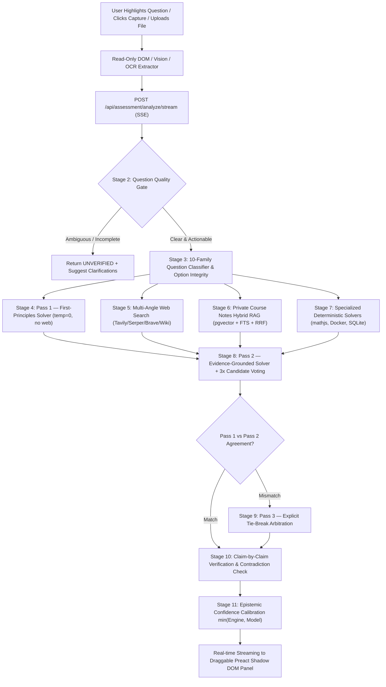

<div align="center">


<br/>

[](https://nodejs.org/)
[](https://www.typescriptlang.org/)
[](https://developer.chrome.com/docs/extensions/mv3/)
[](https://preactjs.com/)
[](#-private-course-notes-rag-knowledge-base)
[](#-specialized-solver-matrix--execution-sandbox)
[](server/eval/dataset.jsonl)
[](#-automatic-gemini--openai-model-resilience)

**An Evidence-First, Solve-Before-Search Academic Copilot & Multi-Stage Verification Engine for Practice Assessments, Coding Problem Sets, and Authorized Coursework.**

[Overview & Ethics](#-overview--core-philosophy) • [11-Stage Pipeline](#-3d-architecture--11-stage-verification-pipeline) • [Features](#-key-features--user-experience) • [Specialized Solvers](#-specialized-solver-matrix--execution-sandbox) • [Course Notes RAG](#-private-course-notes-rag-knowledge-base) • [Quick Start](#-quick-start-guide) • [Configuration](#%EF%B8%8F-configuration--environment-variables) • [Evaluation Benchmarks](#-evaluation-harness--ablation-benchmarks) • [API Reference](#-api-summary--endpoints) • [Troubleshooting](#-troubleshooting--faq)

</div>

---

## 🌟 Overview & Core Philosophy

**ExamAssist AI** is a professional-grade study assistant engineered specifically for students, educators, and engineers tackling challenging problem sets, textbook assignments, and practice assessments. Built as a high-performance **Chrome Manifest V3 Extension** (TypeScript + Preact + Tailwind rendered inside an isolated **Shadow DOM**) paired with a modular **Node.js/Express ESM Backend**, **PostgreSQL + `pgvector` Hybrid Knowledge Base**, and an **Isolated Docker Execution Sandbox**, it transforms raw AI generation into a verified, grounded learning tool.

Unlike generic chatbot wrappers that fabricate citations, invent plausible-sounding code, or guess multiple-choice letters, ExamAssist AI is constructed around **strict epistemic honesty**:

1. **Visible, User-Triggered Interaction Only**:
   - The extension operates strictly in plain sight via a draggable panel or Chrome Side Panel.
   - **Zero proctor evasion, zero screen-share hiding, zero stealth modes, zero background DOM capturing, and zero automated submissions.**
   - All code or text transfers require explicit user action (Copy button or visible interactive diff viewer). The extension **never** injects synthetic keystrokes or writes directly into host page code editors.

2. **Practice Mode vs. Authorized Assessment Mode Gate**:
   - **Practice Mode**: Immediately shows step-by-step reasoning, verified answers, complexity estimates, and test execution results.
   - **Authorized Assessment Mode**: Blurs the final answer behind an explicit user confirmation gate requiring a manual click and displaying a visible academic integrity notice.

3. **Zero Fabricated Fallbacks (Epistemic Transparency)**:
   - If an AI API key is missing or invalid, the backend returns a typed `AI_NOT_CONFIGURED` or `AI_CONFIG_ERROR`.
   - If upstream quotas are exhausted, it throws `AI_RATE_LIMITED` (HTTP 429) rather than returning a guessed option.
   - If the Docker sandbox is offline, code execution returns `SANDBOX_UNAVAILABLE` rather than claiming tests passed.
   - When evidence is contradictory or absent, confidence is calibrated to `UNVERIFIED`—never falsely marked as `HIGH`.

4. **Solve-First, Verify-Second Architecture**:
   - Every problem is first solved from **first principles** ($\text{temperature} = 0$) *without* inspecting external evidence.
   - External evidence (web search + private course notes) is gathered independently and fed into a second reasoning pass.
   - If first-principles reasoning and external evidence disagree, an explicit **Pass 3 Tie-Break Arbitrator** is invoked and the final confidence is capped at `LOW`.

5. **Calibrated Confidence Scoring**:
   $$\text{Final Confidence} = \min\big(\text{Engine Confidence}, \text{Model Confidence}\big)$$
   Confidence is automatically penalized if tool tests fail, if option text differs from option letters, or if reference documents conflict.

---

## 🧊 3D Architecture & 11-Stage Verification Pipeline

<div align="center">
  
</div>

<br/>



### The 11 Pipeline Stages Explained

1. **Stage 1: Read-Only Extraction & Ingestion**:
   - Captures question context via non-invasive DOM extraction (supporting Monaco Editor, CodeMirror 5 & 6, Ace, standard `<textarea>`, Canvas LMS, Moodle, LeetCode, HackerRank, Codeforces, Blackboard, Brightspace), file upload (`PNG`, `JPEG`, `WEBP`, `TXT`, `MD`), or interactive region screenshot.
2. **Stage 2: Question Quality Gate ([`server/pipeline/questionQuality.js`](server/pipeline/questionQuality.js))**:
   - Inspects the raw input for missing option text, truncated code snippets, ambiguous pronouns without context, or prompt-injection attempts.
   - Non-clear questions return `UNVERIFIED` immediately with an actionable explanation (e.g., `MISSING_CODE_SNIPPET` or `AMBIGUOUS_OPTIONS`), preventing hallucinated guesses on malformed inputs.
3. **Stage 3: 10-Family Question Classification & Option Integrity**:
   - Categorizes problems into `MCQ`, `MULTI_SELECT`, `TRUE_FALSE`, `NUMERICAL`, `CODING`, `SQL`, `CONCEPTUAL`, `DEBUGGING`, `OUTPUT_PREDICTION`, or `SHORT_ANSWER`.
   - Validates that option letters (e.g., "A", "B") match their corresponding text bodies to prevent letter-swapping traps.
4. **Stage 4: Pass 1 — First-Principles Solver**:
   - Runs zero-shot deduction at strict temperature $0$ without external search results to isolate core reasoning from search noise.
5. **Stage 5: Multi-Angle Search Retrieval**:
   - Generates 3–6 distinct search queries (definition, conceptual contrast, academic reference) and queries configured providers (`Tavily`, `Serper`, `Brave`, or local Wikipedia mirror) with domain authority scoring (`.edu`, `.gov`, documentation portals).
6. **Stage 6: Private Course Notes Hybrid RAG**:
   - Queries student-uploaded notes using PostgreSQL `pgvector` Cosine Similarity and Full-Text Search (`tsvector`), combined through Reciprocal Rank Fusion (RRF).
7. **Stage 7: Specialized Deterministic Solvers**:
   - Routes numerical problems to `mathjs` & SymPy, coding problems to Docker sandboxed execution, and database queries to in-memory SQLite.
8. **Stage 8: Pass 2 — Evidence-Grounded Solver & 3x Candidate Voting**:
   - Re-evaluates the problem conditioned on verified external citations and tool outputs. For MCQs, runs 3 independent candidate passes across varying sampling temperatures.
9. **Stage 9: Pass 3 — Explicit Tie-Break Arbitration**:
   - Triggered only when Pass 1 and Pass 2 disagree on the final answer. An independent arbitration prompt weighs the first-principles deduction against external evidence, automatically capping the final confidence score at `LOW`.
10. **Stage 10: Claim-by-Claim Verification & Contradiction Detection**:
    - Cross-references each claim against retrieved sources. Detects contradictions between model explanations and retrieved course literature.
11. **Stage 11: Epistemic Confidence Calibration & SSE Streaming**:
    - Assigns the final confidence badge (`HIGH`, `MEDIUM`, `LOW`, or `UNVERIFIED`) based on `min(engineConfidence, modelConfidence)`. Streams stages in real-time via Server-Sent Events (SSE).

---

## 🚀 Key Features & User Experience

### 1. Unified Question Input (Auto-Solve on Interaction)
- **📤 Upload Question**: Accepts images (`PNG`, `JPEG`, `WEBP`) or text files (`.txt`, `.md`). Extracts the text and immediately executes the solver pipeline.
- **📷 Capture Region**: Click and drag an interactive crop rectangle anywhere on your active browser tab. A local preview card allows you to review the crop before sending. If OCR confidence is low ($< 75\%$), a verification banner warns you to review the extracted text.
- **🔍 Extract Page**: Intelligently inspects the active webpage for structured question containers across major Learning Management Systems and competitive coding platforms.
- **📋 Clipboard Paste**: Pasting a question into the text area parses the question and options and automatically triggers solving without requiring a second click.

### 2. Multi-Language Coding Copilot & Sandbox
- **Supported Languages**: Python 3.11+, C++17, C11, Java 17, Node.js (JavaScript), and SQL.
- **Tree-Sitter WASM AST Inspection**: Syntax validation, recursion detection, library call analysis, and AST diff comparison before execution.
- **Property-Based & Mutation Testing**: Uses `fast-check` to generate fuzzing inputs and computes mutation resistance scores (`testStrength %`).
- **Dual Complexity Estimation**:
  - **Analytical**: Structural AST evaluation of loop nestings, recursion branches, and data structure lookups.
  - **Empirical**: Executes the code on 5 geometrically increasing input sizes ($N \in \{10, 100, 1000, 10000, 100000\}$) with multiple trials, subtracts process startup overhead, and fits a log-log regression curve ($\log T = a \log N + b$) with confidence reporting.
- **Interactive Coding Modes**:
  - **▶ Run on Samples**: Executes user code against visible test cases inside the isolated Docker sandbox with zero LLM overhead.
  - **📝 Review Code**: Generates line-by-line feedback on correctness, edge cases, time/space complexity, and a minimal unified diff.
  - **🔄 Translate Code**: Converts solutions across Python, C++, Java, JavaScript, and C, verifying that the translated output passes the same tests.
  - **🐛 Explain Error**: Parses compiler errors or runtime stack traces, identifies root causes using an AST failure taxonomy, and proposes targeted fixes.
  - **🏷️ Concept Tags & Similar Problems**: Suggests algorithmic patterns (e.g., Sliding Window, Disjoint Set Union) and links to related textbook problems.
  - **Progressive Hint Ladder (Lazy 1–4)**: Offers 4 progressive hint levels (Level 1: Direction $\rightarrow$ Level 2: Pseudocode $\rightarrow$ Level 3: Key Edge Cases $\rightarrow$ Level 4: Complete Implementation) generated lazily upon user request.

---

## 🛠️ Specialized Solver Matrix & Execution Sandbox

<div align="center">
  
</div>

<br/>

| Question Family | Deterministic Tooling | Verification & Safety Behavior | Extension Badge |
| :--- | :--- | :--- | :--- |
| **Numerical & Math** (`NUMERICAL`) | `mathjs` expression evaluator + **SymPy** symbolic algebra/calculus service | Extracts formulas, computes exact values, checks against derived prose. Any discrepancy trusts the tool and lowers confidence. | `Verified by: calculator` / `sympy` |
| **Coding & Debugging** (`CODING`, `DEBUGGING`) | Isolated **Docker Sandbox** (`Python`, `JavaScript`, `C`, `C++`, `Java`) | Read-only root FS, no network (`network_mode: none`), non-root UID (1000), strict CPU/RAM/PIDs & 2s wall-clock timeout. | `Verified by: sandbox` |
| **Database Queries** (`SQL`) | Fresh in-memory **SQLite** instance per question | Seeds extracted schema/sample rows and executes a single read-only `SELECT` / `WITH` query. Rejects `DROP`, `DELETE`, `UPDATE`, `INSERT`, `ATTACH`, `PRAGMA`. | `Verified by: sql` |
| **Multiple Choice** (`MCQ`, `MULTI_SELECT`, `TRUE_FALSE`) | **3x Independent Candidate Voting** + Option Integrity Validator | Runs 3 independent candidate passes across varied temperatures, scores against evidence & tool outputs, and verifies exact option letter/text alignment. | `Verified option integrity` |

> [!IMPORTANT]
> The backend **never** executes untrusted code on the host Node.js process. If the Docker sandbox service is offline, coding and SQL questions fall back to static trace analysis and explicitly omit the `Verified by: sandbox` badge.

---

## 📚 Private Course Notes RAG (Knowledge Base)

Students can upload their own lecture slides, textbook chapters, and study guides (`PDF`, `DOCX`, `MD`, `TXT`, up to `10 MiB` per file) via **Extension Options → Course Notes**:

1. **Profile-Scoped Privacy**: Each browser profile generates a local UUID (`X-Local-User-Id`). Documents, chunks, and vectors are strictly isolated to that profile and cascade-delete immediately upon removal.
2. **Heading-Aware Chunking**: Preserves page numbers and Markdown section headers across overlapping `400–800` token windows with SHA-256 content-hash deduplication.
3. **Hybrid Retrieval + Reciprocal Rank Fusion (RRF)**:
   $$\text{RRF}(d) = \sum_{r \in \{\text{vector}, \text{fts}\}} \frac{1}{k + \text{rank}_r(d)}$$
   Combines `pgvector` cosine similarity with PostgreSQL `tsvector` full-text search, filters by minimum RRF relevance threshold (`KB_MIN_RELEVANCE_RRF=0.014`), and reranks the top 5 passages.
4. **Epistemic Humility**: Course notes are injected as `course_notes` evidence—never treated as infallible truth. If a user's notes conflict with established domain facts or deterministic tools, the panel surfaces both perspectives.
5. **Official Language Documentation KB**: Built-in retrieval index covering the Python standard library, cppreference, Java SE docs, and MDN Web Docs with exact `doc` and `section` citations.

---

## 🤖 Automatic Gemini & OpenAI Model Resilience

The backend AI client ([`server/aiClient.js`](server/aiClient.js)) features built-in multi-tier fallback resilience designed to bypass upstream rate limits, quota limits (HTTP 429), and temporary outages (HTTP 503):

- **Automatic Active Model Fallback**: If `OPENAI_MODEL` is configured to a Gemini model (or points to `generativelanguage.googleapis.com`) and returns a `429` (Quota Exhausted) or `503` (High Demand), the client automatically rotates through available active models:
  $$\text{gemini-3.7-flash} \longrightarrow \text{gemini-3.6-flash} \longrightarrow \text{gemini-3.5-flash} \longrightarrow \text{gemini-3.1-flash-lite} \longrightarrow \text{gemini-3.5-flash-lite}$$
- **Working Model Persistence**: Once a working model is discovered, the client caches it in memory as `activeWorkingModel`, sending all subsequent requests directly to that model without incurring retry delays.
- **Full Vision & Tool Fallback**: Fallback logic is mirrored across text completion, multimodal vision extraction (`generateVisionJson`), and agentic tool loops (`runToolLoop`).

---

## 🚀 Quick Start Guide

### Prerequisites
- **Node.js 20+** and `npm`
- **Google Chrome** (or Chromium-based browser like Brave or Edge)
- **Docker & Docker Compose** *(optional for basic mode; required for isolated code sandbox and pgvector Course Notes)*

---

### Step 1: Clone the Repository & Configure Environment

```bash
git clone https://github.com/your-username/ExamAI-Study-Assistant.git
cd ExamAI-Study-Assistant

# Configure Backend Environment
cd server
cp .env.example .env
```

Edit `server/.env` with your API credentials:
```ini
PORT=8787
HOST=127.0.0.1
NODE_ENV=development

# For OpenAI:
OPENAI_API_KEY=sk-proj-your-openai-key-here
OPENAI_MODEL=gpt-4o

# OR for Google Gemini (OpenAI-compatible):
# OPENAI_API_KEY=AIzaSy...your-gemini-key
# OPENAI_BASE_URL=https://generativelanguage.googleapis.com/v1beta/openai/
# OPENAI_MODEL=gemini-3.7-flash
```

---

### Step 2: Start the Backend Service

#### Option A: Direct Node.js (Fastest Setup)
```bash
cd server
npm install
npm start
```

Verify that the server is active:
```bash
curl http://localhost:8787/api/health
```

#### Option B: Full Stack with Docker Compose (Sandbox + pgvector RAG)
```bash
# From the project root:
docker compose up --build -d
```
This starts:
- `examassist-backend` on `127.0.0.1:8787`
- `course-notes-db` (PostgreSQL 16 + `pgvector`) on private internal network
- `examassist-sandbox` (Docker code/SQL/SymPy runner) on private internal network

---

### Step 3: Build & Load the Chrome Extension

1. **Install dependencies and build the extension**:
   ```bash
   cd extension
   npm install
   npm run build
   ```
2. **Load into Google Chrome**:
   - Open Chrome and navigate to `chrome://extensions/`.
   - Enable **Developer mode** (toggle switch in the top-right corner).
   - Click **Load unpacked** in the top-left corner.
   - Select the [`extension/`](extension/) directory (containing `manifest.json`, `dist/`, `content.js`, `sidepanel.js`, etc.).

---

### Step 4: Test on Practice Content

1. Open [`sample-assessment.html`](sample-assessment.html) in your browser:
   ```bash
   # In project root:
   python3 -m http.server 5174 --bind 127.0.0.1
   # Open http://127.0.0.1:5174/sample-assessment.html in Chrome
   ```
2. Click the extension icon in the toolbar or click the floating **✨ AI Assist** button on the page.
3. Highlight any question or click **📷 Capture Region** / **📤 Upload Question** to see immediate streaming analysis!

---

## ⚙️ Configuration & Environment Variables

All backend configuration is defined in [`server/.env`](server/.env.example):

| Variable | Default | Purpose / Description |
| :--- | :--- | :--- |
| `PORT` | `8787` | Port the Express server listens on. |
| `HOST` | `127.0.0.1` | Host address binding (defaults to localhost for security). |
| `OPENAI_API_KEY` | *(required)* | API key for LLM calls (OpenAI or Gemini). |
| `OPENAI_MODEL` | `gpt-4o` | Primary model (`gpt-4o`, `gemini-3.7-flash`, etc.). |
| `OPENAI_VISION_MODEL` | `gpt-4o` | Model used for multimodal screenshot extraction. |
| `OPENAI_BASE_URL` | *(optional)* | Custom API base URL (e.g., `https://generativelanguage.googleapis.com/v1beta/openai/`). |
| `TAVILY_API_KEY` | *(optional)* | API key for Tavily academic web search. |
| `SERPER_API_KEY` | *(optional)* | API key for Google Serper search provider. |
| `BRAVE_SEARCH_API_KEY` | *(optional)* | API key for Brave search provider. |
| `KB_DATABASE_URL` | *(optional)* | PostgreSQL connection string with `pgvector` for Course Notes. |
| `KB_MIN_RELEVANCE_RRF` | `0.014` | Minimum Reciprocal Rank Fusion score to admit note chunks. |
| `SANDBOX_URL` | `http://127.0.0.1:8790` | Internal URL of the Docker execution sandbox service. |
| `SANDBOX_TIMEOUT_MS` | `2000` | Wall-clock execution ceiling for untrusted student code. |
| `AGENT_MAX_USD` | `0.05` | Maximum spend ceiling per question in tool-calling agent mode. |
| `OTEL_REDACT_CODE_AND_QUESTIONS` | `true` | When true, masks code and question strings in OTel trace logs. |

---

## 📊 Evaluation Harness & Ablation Benchmarks

ExamAssist AI features an offline evaluation suite located in [`server/eval/`](server/eval/):

- **[`server/eval/dataset.jsonl`](server/eval/dataset.jsonl)**: **236 academically verified questions** across 14 subjects (Data Structures, OS, DBMS, Networks, Python, SQL, Math, Physics, Chemistry, Biology, Economics, History, Literature) and 7 question families (`MCQ`, `MULTI_SELECT`, `TRUE_FALSE`, `NUMERICAL`, `CODING`, `SQL`, `CONCEPTUAL`).
- **[`server/eval/code-dataset.jsonl`](server/eval/code-dataset.jsonl)**: **185 multi-language coding problems** across Python, C++, Java, C, JavaScript, and SQL, complete with hidden test suites.
- **[`server/eval/redteam.jsonl`](server/eval/redteam.jsonl)**: **40 adversarial & malformed prompts** (ambiguous wording, missing code, prompt-injection attacks) that must be classified as `UNVERIFIED` or flagged for clarification.

### Ablation Configurations ([`server/eval/configs/`](server/eval/configs/))

| Config | Name | Enabled Pipeline Components |
| :---: | :--- | :--- |
| **`a`** | `a_single_pass` | Single zero-shot pass (no search, no tie-break, no tools) |
| **`b`** | `b_solve_evidence` | Pass 1 (first-principles) + Pass 2 (web/evidence-grounded) |
| **`c`** | `c_solve_tiebreak` | Solve-first + evidence + explicit Pass 3 tie-break arbitration |
| **`d`** | `d_rag` | `c_solve_tiebreak` + Private Course Notes (`pgvector` + FTS hybrid RRF) |
| **`e`** | `e_specialized` | `d_rag` + `mathjs`/SymPy calculator, Docker sandbox, SQLite engine, 3x MCQ voting |
| **`f`** | `f_agent` | Bounded native tool-calling loop (`maxToolCalls=6`, token/USD ceilings) with static fallback |

### Running Benchmark Suites

```bash
cd server

# 1. Deterministic fast smoke check (mock-based, verifies pipeline invariants)
npm run eval:smoke

# 2. Quality Gate check against measured baseline (evaluates full 236-question dataset)
npm run eval:gate

# 3. Comprehensive multi-language coding evaluation & red-team containment
npm run eval:code
```

> **Measured Baseline Accuracy**: Configuration `a_single_pass` achieves **91.53% accuracy** on the 236-question academic suite with **100% UNVERIFIED detection** on incorrect answers. See [`docs/EVAL_REPORT.md`](docs/EVAL_REPORT.md) for full metrics.

---

## 🔌 API Summary & Endpoints

### Core Assessment API
| Method | Endpoint | Description |
| :--- | :--- | :--- |
| `GET` | `/api/health` | Returns service status, active AI model, sandbox status, and RAG status. |
| `GET` | `/api/config` | Returns supported question families, modes, and rate limits. |
| `POST` | `/api/assessment/analyze` | Synchronous analysis returning full structured assessment JSON. |
| `POST` | `/api/assessment/analyze/stream` | Real-time **Server-Sent Events (SSE)** stream of the 11 pipeline stages. |

### Coding & Sandbox API
| Method | Endpoint | Description |
| :--- | :--- | :--- |
| `POST` | `/api/code/analyze` | Comprehensive coding solver: AST parsing, property tests, mutation testing, log-log complexity. |
| `POST` | `/api/code/hint` | Lazy hint generation (`level: 1..4`) with retry logic and typed errors. |
| `POST` | `/api/code/run-samples` | Executes code against visible sample tests in the sandbox without LLM calls. |
| `POST` | `/api/code/review` | Reviews user code for bugs, edge cases, and returns a minimal unified diff. |
| `POST` | `/api/code/translate` | Translates code across Python, C++, Java, JS, and C and verifies on test cases. |
| `POST` | `/api/code/explain-error` | Diagnoses compiler errors/runtime stderr and provides a minimal fix diff. |
| `POST` | `/api/code/ast` | Runs Tree-Sitter WASM AST structural inspection on code snippets. |

### Vision, Knowledge Base & Observability API
| Method | Endpoint | Description |
| :--- | :--- | :--- |
| `POST` | `/api/vision/extract` | Processes screenshot OCR + Vision ($< 4\text{MB}$, in-memory only, low-OCR confidence flag). |
| `POST` | `/api/kb/documents` | Multipart upload (`PDF`, `DOCX`, `MD`, `TXT`) for profile-scoped Course Notes. |
| `GET` | `/api/kb/documents` | Lists indexed documents and byte usage for current `X-Local-User-Id`. |
| `DELETE` | `/api/kb/documents/:id` | Cascade-deletes document, chunks, and embeddings for `X-Local-User-Id`. |
| `POST` | `/api/kb/search` | Searches official language docs + course notes with `doc` and `section` citations. |
| `GET` | `/api/traces` | Localhost-only (`127.0.0.1`) OpenTelemetry trace viewer with automatic PII redaction. |

### Model Context Protocol (MCP) Server
ExamAssist AI includes a standalone MCP server in [`server/mcp/server.js`](server/mcp/server.js) that exposes tool capabilities directly to AI agents:
```bash
cd server
npm run mcp
```
Exposes tools:
- `run_code`: Executes untrusted code inside the Docker sandbox.
- `run_tests`: Executes unit tests against a target function.
- `kb_search`: Searches official documentation and Course Notes RAG.

---

## 🧪 Testing, Linting & Packaging

The project enforces strict code quality across both the server and extension:

```bash
# Root Monorepo Commands
npm run lint          # Runs ESLint/lint scripts in both server and extension
npm test              # Runs backend node --test and extension vitest suites
npm run build         # Compiles the extension via Vite into extension/dist/
npm run pack          # Builds a clean release zip (ExamAssist-AI-clean.zip)

# Server-Specific Commands
cd server
npm run lint          # Syntax check across all ESM modules
npm test              # Executes 100+ unit and integration tests
npm run eval:smoke    # Deterministic pipeline validation
npm run eval:gate     # Quality regression gate
npm run pack          # Checks .dockerignore/.gitignore and creates clean release archive

# Extension-Specific Commands
cd extension
npm run typecheck     # Strict TypeScript type verification
npm test              # Vitest + jsdom DOM adapter tests
npm run test:e2e      # Playwright E2E tests against Monaco, CodeMirror & textarea fixtures
```

---

## 🔒 Security, Privacy & Sandboxing Guarantees

1. **Host Isolation**: Untrusted code from student questions or web pages is **never** executed on the host system. It runs in a containerized environment with:
   - Read-only root filesystem
   - `network_mode: none` (no outbound internet or LAN connectivity)
   - Non-root user execution (`uid 1000`)
   - 2-second wall-clock execution ceiling
   - Strict memory (`512MB`) and process (`pids_limit: 64`) limits.
2. **Zero Screenshot Persistence**: Screenshot crops submitted to `/api/vision/extract` are processed purely in-memory buffers and immediately discarded (`imagePersisted: false`). No student screenshots are stored on disk.
3. **Restricted Chrome Permissions**:
   - The extension manifest explicitly omits broad `<all_urls>` host permissions.
   - Per-site permissions are requested dynamically via `chrome.permissions.request` when the user activates the assistant on a new domain.
4. **Localhost-Bound Tracing**: The OpenTelemetry trace viewer (`/api/traces`) strictly rejects non-loopback requests with HTTP 403 and automatically redacts code and question text.

---

## ❓ Troubleshooting & FAQ

### Q1: I see `Assessment Error: 429 status code (no body)` when submitting a question.
**Cause**: The configured Gemini or OpenAI API key has exhausted its minute/tier rate limits on the primary model.  
**Resolution**: The backend includes automatic candidate model fallback. If you are using Google Gemini, set your `.env` to:
```ini
OPENAI_MODEL=gemini-3.7-flash
OPENAI_BASE_URL=https://generativelanguage.googleapis.com/v1beta/openai/
```
The server will automatically switch between `gemini-3.7-flash`, `gemini-3.6-flash`, `gemini-3.5-flash`, and `gemini-3.1-flash-lite` to ensure continuity.

### Q2: Why does the panel display `Verified by: sandbox` as missing?
**Cause**: The Docker execution sandbox is offline or `SANDBOX_URL` is unreachable.  
**Resolution**: In direct Node.js development mode, the sandbox is optional. Coding questions will still be analyzed statically via the Tree-Sitter AST engine. To enable live test execution, start the sandbox via `docker compose up examassist-sandbox -d`.

### Q3: How do I change the backend URL in the extension for a remote server?
**Resolution**: Click the gear icon in the extension panel header to open the settings view. Enter your custom backend API base URL (e.g., `https://your-server.com`) and click **Save**.

### Q4: Can I use this on platforms with strict Content Security Policies (CSP)?
**Resolution**: Yes. The extension's UI is mounted inside a dedicated **Shadow DOM** with encapsulated styles, preventing host page CSS and CSP from interfering with panel controls.

---

## 📄 License & Academic Attribution

ExamAssist AI is released under the **MIT License**.

Developed for responsible academic study, interactive homework assistance, and educational problem-solving. Always verify that AI tool usage is explicitly permitted by your instructor or institution before using in coursework.
