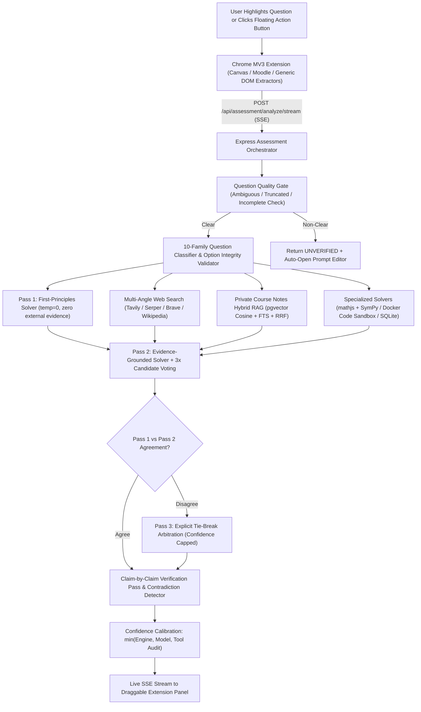

<div align="center">


<br/>

[](https://nodejs.org/)
[](https://developer.chrome.com/docs/extensions/mv3/)
[](#private-course-notes-rag-knowledge-base)
[](#specialized-solver-matrix--execution-sandbox)
[](server/eval/dataset.jsonl)

**An Evidence-First, Solve-Before-Search Academic Copilot & Multi-Stage Verification Engine for Practice Assessments and Authorized Coursework.**

[Architecture & 3D Pipeline](#3d-architecture--multi-stage-pipeline) • [Quick Start](#quick-start) • [Course Notes RAG](#private-course-notes-rag-knowledge-base) • [Specialized Solvers](#specialized-solver-matrix--execution-sandbox) • [Evaluation & Ablations](#evaluation-harness--ablation-benchmarks) • [API Reference](#api-summary)

</div>

---

## 🌟 Overview & Core Philosophy

**ExamAssist AI** is a Chrome Manifest V3 extension paired with a modular Node.js/Express backend, a PostgreSQL + `pgvector` hybrid knowledge base, and an isolated Docker execution sandbox. It assists learners on practice tests, textbook problem sets, and assessments where AI/web usage is explicitly authorized.

Unlike generic chat wrappers that hallucinate citations or guess options, ExamAssist AI enforces **strict epistemic honesty**:

- **Visible, User-Triggered Interaction Only**: Never hides UI, never evades screen sharing or proctoring, and never auto-clicks or auto-submits answers.
- **Zero Fabricated Fallbacks**: Missing keys, rate limits, or unreachable services return typed errors (`AI_NOT_CONFIGURED`, `AI_RATE_LIMITED`, `AI_UNAVAILABLE`, `AI_TIMEOUT`) or `UNVERIFIED`—never a canned or guessed option.
- **Solve-First, Verify-Second**: Solves every problem from first principles *before* inspecting retrieved evidence, then cross-examines both passes and triggers a tie-breaker when first-principles reasoning and external sources disagree.
- **Calibrated Confidence**: Final confidence (`HIGH`, `MEDIUM`, `LOW`, `UNVERIFIED`) is strictly bounded by `min(modelConfidence, engineConfidence)` and downgraded automatically if tools disagree or evidence is missing.

---

## 🧊 3D Architecture & Multi-Stage Pipeline

<div align="center">
  
</div>

<br/>



---

## 🛠️ Specialized Solver Matrix & Execution Sandbox

<div align="center">
  
</div>

<br/>

| Question Family | Deterministic Tooling | Verification & Safety Behavior | Extension Badge |
| :--- | :--- | :--- | :--- |
| **Numerical & Math** (`NUMERICAL`) | `mathjs` expression evaluator + **SymPy** symbolic algebra/calculus service | Extracts formulas, computes exact values, checks against derived prose. Any discrepancy trusts the tool and lowers confidence. | `Verified by: calculator` / `sympy` |
| **Coding & Debugging** (`CODING`, `DEBUGGING`) | Isolated **Docker Sandbox** (`Python`, `JavaScript`, `C`, `C++`, `Java`) | Read-only root FS, no network (`network_mode: none` / internal), non-root UID, strict CPU/RAM/PIDs & 2s wall-clock timeout. | `Verified by: sandbox` |
| **Database Queries** (`SQL`) | Fresh in-memory **SQLite** instance per question | Seeds extracted schema/sample rows and executes a single read-only `SELECT` / `WITH` query. Rejects `DROP`, `DELETE`, `UPDATE`, `INSERT`, `ATTACH`, `PRAGMA`. | `Verified by: sql` |
| **Multiple Choice** (`MCQ`, `MULTI_SELECT`, `TRUE_FALSE`) | **3x Independent Candidate Voting** + Option Integrity Validator | Runs 3 independent candidate passes across varied temperatures, scores against evidence & tool outputs, and verifies exact option letter/text alignment. | `Verified option integrity` |

> [!IMPORTANT]
> The backend **never** executes untrusted code on the host Node.js process. If the Docker sandbox service is offline, coding and SQL questions fall back to static trace analysis and explicitly omit the `Verified by: sandbox` badge.

---

## 📚 Private Course Notes RAG (Knowledge Base)

Students can upload their own lecture slides, textbook chapters, and study guides (`PDF`, `DOCX`, `MD`, `TXT`, up to `10 MiB` per file) via **Extension Options → Course Notes**:

1. **Profile-Scoped Privacy**: Each browser profile generates a local UUID (`X-Local-User-Id`). Documents, chunks, and vectors are strictly isolated to that profile and cascade-delete immediately upon removal.
2. **Heading-Aware Chunking**: Preserves page numbers and Markdown section headers across overlapping `400–800` token windows with SHA-256 content-hash deduplication.
3. **Hybrid Retrieval + Reciprocal Rank Fusion (RRF)**:
   $$\text{RRF}(d) = \sum_{r \in \{\text{vector}, \text{fts}\}} \frac{1}{k + \text{rank}_r(d)}$$
   Combines `pgvector` cosine similarity with PostgreSQL `tsvector` full-text search, filters by minimum RRF relevance threshold (`KB_MIN_RELEVANCE_RRF=0.014`), and reranks the top 5 passages.
4. **Epistemic Humility**: Course notes are injected as `course_notes` evidence—never treated as infallible truth. If a user's notes conflict with established domain facts or deterministic tools, the panel surfaces both perspectives.

---

## 🚀 Quick Start

### Prerequisites

- **Node.js 20+** and `npm`
- **Google Chrome** (or any Chromium-based browser)
- **Docker Desktop** with Docker Compose v2 *(optional for backend-only mode; required for `pgvector` Course Notes & isolated code/SQL sandbox)*

### 1. Run the Full Stack (Docker Compose)

```bash
cp .env.example .env
# Add your OPENAI_API_KEY (or Gemini OpenAI-compatible key) in .env
docker compose up --build -d
curl http://localhost:8787/api/health
```

Compose launches three coordinated services:

| Service | Role | Network Exposure |
| :--- | :--- | :--- |
| `examassist-backend` | Express SSE/JSON API, reasoning pipeline, RAG orchestrator | `127.0.0.1:8787` |
| `course-notes-db` | PostgreSQL 16 + `pgvector` for profile-scoped Course Notes | Private Docker network |
| `examassist-sandbox` | Locked-down Python/JS/C/C++/Java/SQLite/SymPy runner | Private Docker network (`127.0.0.1:8791` health check) |

### 2. Run the Backend Directly (Node.js)

```bash
cd server
npm install
cp .env.example .env
# Configure OPENAI_API_KEY, OPENAI_MODEL, and optional OPENAI_BASE_URL in server/.env
npm start
```

Check runtime health and active capabilities at any time:

```bash
curl -s http://localhost:8787/api/health | jq
```

```json
{
  "status": "ok",
  "service": "ExamAssist AI Assessment Copilot",
  "version": "2.1.0",
  "aiConfigured": true,
  "ragEnabled": false,
  "sandboxEnabled": false,
  "searchProvider": "none",
  "model": "gemini-3.5-flash-lite"
}
```

### 3. Load the Chrome MV3 Extension

1. Open `chrome://extensions/` in Chrome and enable **Developer mode**.
2. Click **Load unpacked** and select the [`extension/`](extension/) folder.
3. Open any practice page (or serve [`sample-assessment.html`](sample-assessment.html) via `python3 -m http.server 5174 --bind 127.0.0.1`).
4. Highlight a question or click the **✨ AI Assist** floating button to stream real-time classification, retrieval, solving, and verification steps.

---

## 📊 Evaluation Harness & Ablation Benchmarks

The repository includes a rigorous offline evaluation suite in [`server/eval/`](server/eval/):

- **[`server/eval/dataset.jsonl`](server/eval/dataset.jsonl)**: **236 labeled practice questions** spanning Data Structures, Operating Systems, DBMS, Computer Networks, Python, SQL, Quantitative Aptitude, Mathematics, Physics, Chemistry, Biology, Economics, History, and Literature across `MCQ`, `MULTI_SELECT`, `TRUE_FALSE`, `NUMERICAL`, `CODING`, `SQL`, and `CONCEPTUAL` formats.
- **[`server/eval/redteam.jsonl`](server/eval/redteam.jsonl)**: **40 adversarial & broken prompts** (ambiguous, missing options, contradictory premises, truncated code, prompt-injection attempts) that must be flagged or marked `UNVERIFIED`.

### Ablation Configurations (`server/eval/configs/`)

| Config Name | Pipeline Capabilities Enabled |
| :--- | :--- |
| `a_single_pass` | Single zero-shot reasoning pass (no search, no tie-break, no tools) |
| `b_solve_evidence` | Pass 1 (first-principles) + Pass 2 (web/Wikipedia evidence) |
| `c_solve_tiebreak` | Solve-first + evidence + explicit Pass 3 tie-break arbitration |
| `d_rag` | `c_solve_tiebreak` + Private Course Notes (`pgvector` + FTS hybrid RRF) |
| `e_specialized` | `d_rag` + `mathjs`/SymPy calculator, Docker code runner, SQLite engine, 3x MCQ voting |
| `f_agent` | Bounded native tool-calling loop (`maxToolCalls=6`, token/time/USD ceilings) with static fallback |

### Run Evaluations & CI Quality Gates

```bash
cd server

# Fast deterministic CI smoke check (mock AI, zero API cost)
npm run eval:smoke

# Regression gate against baseline accuracy & safety thresholds
npm run eval:gate

# Live evaluation on a specific ablation config with call & concurrency caps
EVAL_MAX_CALLS=100 EVAL_CONCURRENCY=3 npm run eval -- --config e_specialized --limit 25
```

Every run outputs structured JSON and a full Markdown calibration report in `server/eval/results/<timestamp>_<config>.md`.

---

## 🧪 Testing & Quality Assurance

```bash
cd server
npm run lint        # Syntax & static checks across all 51 ESM modules
npm test            # 77-test node --test suite (unit, integration, RAG, extractors, solvers, agent)
npm run eval:smoke  # End-to-end evaluation pipeline verification
```

---

## 🔌 API Summary

| Method | Endpoint | Description |
| :--- | :--- | :--- |
| `GET` | `/api/health` | Service status + `aiConfigured`, `ragEnabled`, `sandboxEnabled`, `searchProvider`, `model` |
| `GET` | `/api/config` | Supported question types, operating modes, and rate limits |
| `POST` | `/api/assessment/analyze` | Synchronous full-pipeline analysis returning structured JSON |
| `POST` | `/api/assessment/analyze/stream` | Real-time **Server-Sent Events (SSE)** stream (`classified` → `searching` → `retrieved` → `solving` → `verifying` → `done`) |
| `POST` | `/api/question/classify` | Rule-based 10-type classifier & subject/difficulty detector |
| `POST` | `/api/search` | Multi-angle academic query generator and deduplicated ranker |
| `POST` | `/api/evidence/verify` | Claim-level support & contradiction verifier |
| `POST` | `/api/kb/documents` | Multipart upload (`PDF`/`DOCX`/`MD`/`TXT`) for profile-scoped Course Notes |
| `GET` | `/api/kb/documents` | Lists indexed documents and byte usage for `X-Local-User-Id` |
| `DELETE` | `/api/kb/documents/:id` | Cascade-deletes document, chunks, and embeddings for `X-Local-User-Id` |
| `POST` | `/api/kb/search` | Hybrid `pgvector` + full-text RRF diagnostic search |

---

## 🛡️ Academic Integrity, Privacy & Security

- **Permitted Use Only**: Designed strictly for self-study, practice tests, and assessments where external AI/search tools are explicitly authorized.
- **Zero Stealth / Zero Automation**: The panel is always visible, user-triggered, and never interacts with page form controls or submission buttons.
- **Secret Hygiene**: API keys live exclusively in `server/.env` (untracked by Git) and are never bundled into extension code.
- **Detailed Documentation**:
  - [Architecture Deep Dive](docs/ARCHITECTURE.md)
  - [API Reference & Schemas](docs/API.md)
  - [Security & Sandbox Boundaries](docs/SECURITY.md)
  - [Workflow & Developer Guide](docs/WORKFLOW.md)
