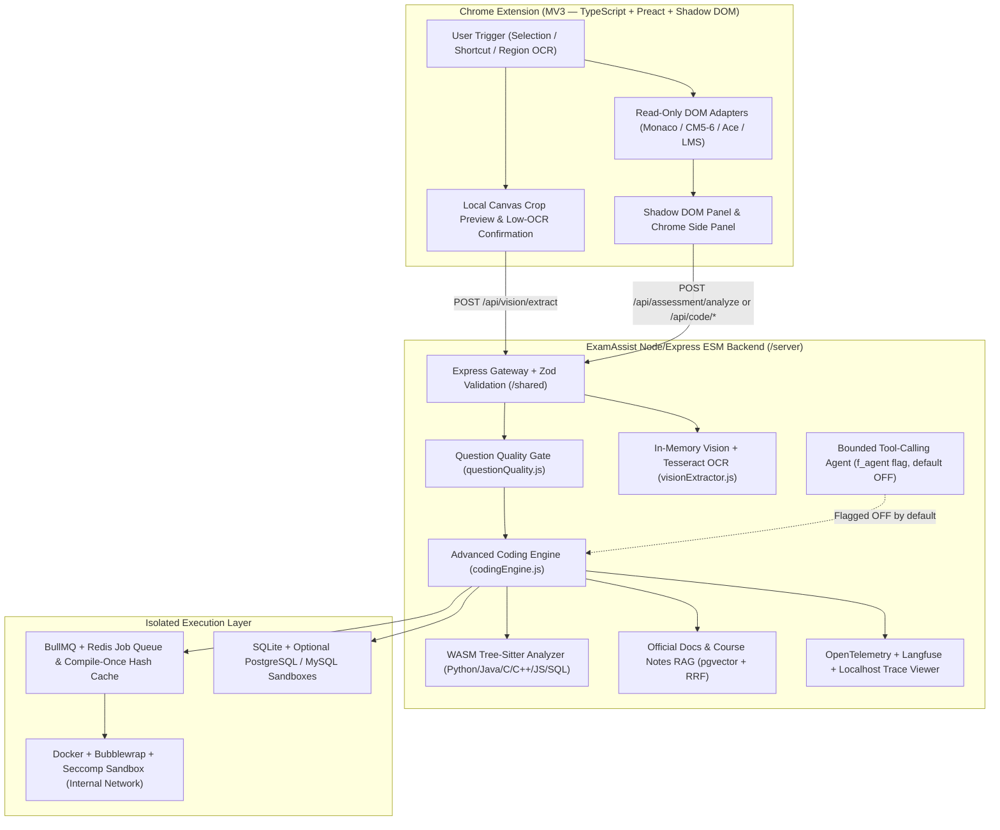

# ExamAssist AI — System Architecture (v2.2.0)

ExamAssist AI is a production-grade, evidence-first academic study assistant and coding copilot built on a **TypeScript + Vite + Preact + Tailwind CSS + Shadow DOM** Chrome Manifest V3 extension (`/extension`), a **Node.js / Express ESM** reasoning backend (`/server`), shared **Zod** validation contracts (`/shared`), and an isolated **Docker + Bubblewrap + Seccomp** multi-language sandbox (`/server/sandbox`).

---

## 1. End-to-End Architecture

---

## 2. Module Breakdown

1. **`/extension` (TypeScript + Vite + Preact + Tailwind CSS)**:
   - `src/extractors/`: Read-only editor (`Monaco`, `CodeMirror 5/6`, `Ace`, `textarea`, `pre/code`) and platform (`Moodle`, `Canvas`, `LeetCode`, `HackerRank`, `GeeksforGeeks`) adapters.
   - `src/trigger/`: User-initiated selection floating button and rectangle region-capture overlay.
   - `src/messaging/`: Zod-validated runtime message bus between content script, service worker, popup, and side panel.
   - `src/ui/`: Preact + Tailwind Shadow DOM copilot card (`#examai-shadow-host`) with lazy 4-level hint ladder, unified code diff viewer, sandbox test table, log-log complexity chart, and vision preview/confirmation workflow.
2. **`/shared` & `/server/schemas.js` (Shared Zod Schemas)**:
   - Strictly validates every API request, response, and extension runtime message (`AnalyzeRequestSchema`, `CodeAnalysisRequestSchema`, `CodeHintRequestSchema`, `VisionExtractRequestSchema`, `ExtensionRuntimeMessageSchema`).
3. **`/server/pipeline/`**:
   - `treeSitterAnalyzer.js`: `web-tree-sitter` WASM AST analysis for Python, Java, C, C++, JavaScript, and SQL (syntax errors with line/column, function/loop/recursion structure, undefined identifiers, static complexity).
   - `executionQueue.js`: BullMQ + Redis execution queue with per-user concurrency limits, queue timeouts, and compile-once SHA-256 binary caching.
   - `codingEngine.js`: Candidate generation, property-based tests (`fast-check` + Python `Hypothesis`), differential testing against `brute_force`, mutation testing (`testStrength` %), 6-category failure taxonomy repair loop (`<= 3` attempts), candidate ranking, and 5-size log-log empirical complexity regression.
   - `visionExtractor.js`: 4MB size cap, MIME + magic-byte validation, in-memory Tesseract OCR + multimodal Vision LLM, `ocrConfidence` calculation, and zero image persistence (`imagePersisted: false`).
   - `observabilityAndSafety.js`: W3C OpenTelemetry stage/tool spans, default code/question redaction, OTLP & Langfuse exporters, and localhost-only trace viewer.
4. **`/server/kb/`**:
   - `officialDocsCorpus.js` & `knowledgeBase.js`: Curated official language reference chunks (Python 3, cppreference C/C++, Java SE, MDN JS) + `pgvector` user course notes with `doc` + `section` citations and strict relevance threshold (`[]` below threshold).
5. **`/server/mcp/server.js`**:
   - Optional Model Context Protocol (MCP) JSON-RPC 2.0 server exposing `run_code`, `run_tests`, and `kb_search` without accuracy claims.
